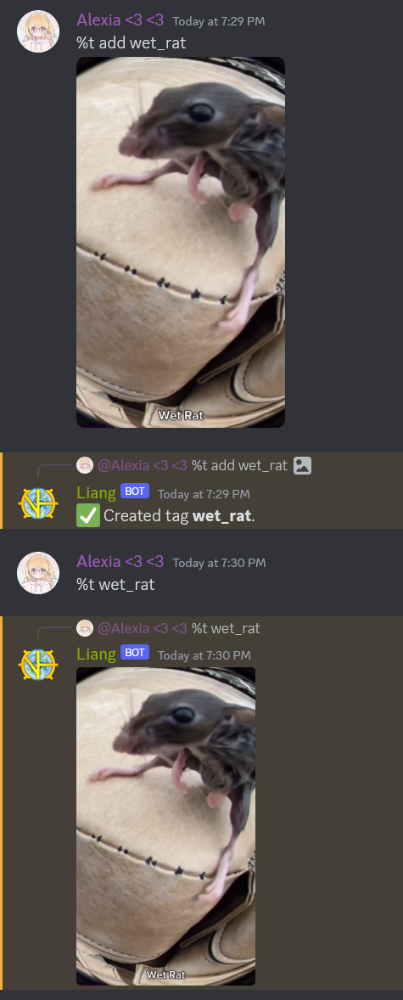
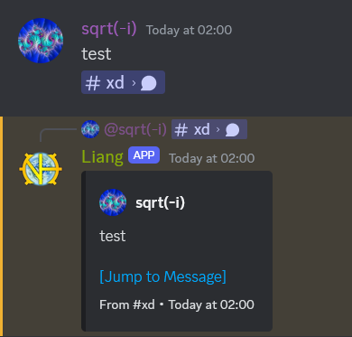
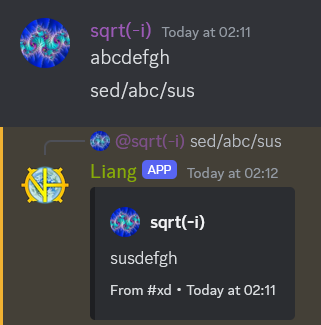
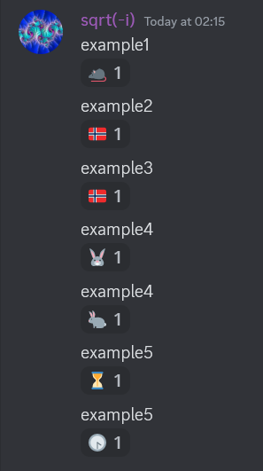
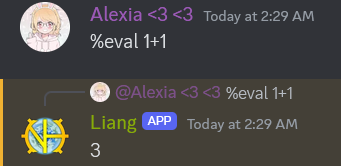

<div align="center"">
    <h1>EL LEVERT JR</h1>
    <br>
    
</div>

<h4 align="center">Romanian version of Leveret by Neeve</h4>

<div align="center">
    <a href="https://opensource.org/license/mit/">
        
    </a>
    <a href="https://discord.js.org/#/">
        
    </a>
    <a href="https://nodejs.org/en">
        
    </a>
    <a href="https://github.com/WeslayCodes/BoarBot/main">
        
    </a>
</div>

<div align="center">
  <a href="#installation">Installation</a>
  •
  <a href="#features">Features</a>
  •
  <a href="#commands">Commands</a>
  •
  <a href="#cli-commands">CLI</a>
  •
  <a href="#websocket-api">WebSocket</a>
  •
  <a href="#evaluation-api">API</a>
  •
  <a href="#configuration">Configuration</a>
  •
  <a href="#startup">Startup</a>
  •
  <a href="#importing">Importing</a>
  •
  <a href="#amogus">Amogus</a>
</div>

# Installation

> [!WARNING]
> This project only supports **Node.js 20.x and 21.x**.
>
> **Node.js 21.7.3 is the final supported version.**
>
> Node.js 22 and newer are not supported.
>
> Use Node.js 20.19.6 if you plan on enabling the inspector features.

Install the bot with:

```bash
npm install --omit=optional
```

Optional runtime support:

- `vm2` support depends on the optional `vm2` package being available
- external language eval support depends on the separate external VM setup being installed on the machine

# Configuration

This section is for bot setup. It covers credentials, feature toggles, interface settings, and the main config files.

## Credentials

You can provide bot credentials in any of these ways:

- `config/auth.json`
- `config/auth.env`
- existing environment variables

Supported environment variable names:

- `LEVERET_TOKEN`
- `LEVERET_OWNER`

If `config/auth.json` exists, the bot uses that file for `token` and `owner`.

If there is no `config/auth.json`, the bot looks for `config/auth.env` and then for the matching environment variables.

`config/auth.json` example:

```json
{
    "token": "bot token",
    "owner": "your discord id"
}
```

`config/auth.env` example:

```dotenv
LEVERET_TOKEN=your bot token
LEVERET_OWNER=your discord id
```

## Main bot config

`config/config.json` controls the main bot behavior, including command prefixes, limits, enabled features, logging, and paths.

Important groups of settings:

- Discord text interface: `cmdPrefix`, `interactionTimeout` (active button session lifespan in seconds)
- CLI interface: `enableCliCommands`, `cliCmdPrefix`
- Eval modes and execution: `enableEval`, `enableVM2`, `enableOtherLangs`
- VM HTTP settings: `vmHttp` (`maxUploadSize`, `maxDownloadSize`, `maxRequests`, `rateLimitWindow`, `allowLocalhostRequests`, `allowFilesystemRequests`)
- Inspector and debugging: `vmInspector` (`enable`, `enableUser`, `connectTimeout`, `userConnectTimeout`, `userActionTimeout`, `port`)
- Tags and quotas: `maxTagNameLength`, `tagNameRegex`, `maxTagSize` (per-tag limits in kb for `text`, `script`, and `binary`; `-1` for unlimited), `maxQuota` (total storage quota in kb; `-1` for unlimited), `maxTagCount` (`-1` for unlimited)
- Reply and output limits: `outCharLimit`, `outLineLimit`, `embedCharLimit`, `embedLineLimit`
- Major features: `enablePreviews`, `enableSed`, `enablePermissions`, `enableReminders`
- Logging and file paths: log files, log level, database path, command paths, Discord log settings

## Reactions config

`config/reactions.json` controls automatic emoji reactions.

At minimum, it can simply disable the feature:

```json
{
    "enableReacts": false
}
```

If reactions are enabled, the file defines the bracket reactions and the word-triggered reactions:

```json
{
    "enableReacts": true,
    "parens": {
        "left": ["left parenthesis emoji ids"],
        "right": ["right parenthesis emoji ids"]
    },
    "funnyWords": [
        {
            "word(s)": "word or [word1, word2]",
            "react(s)": "emoji or [emoji1, emoji2]"
        }
    ]
}
```

## Interface and feature notes

- If `enableCliCommands` is off, the local CLI section in this README does not apply.
- If `enableWebsocket` is off, the WebSocket API is not available.
- If `enableEval` is off, eval commands are not available.
- If `enableVM2` is off, VM2 eval and VM2 tag execution are not available.
- If `enableOtherLangs` is off, `c`, `cpp`, and `py` eval modes are not available.
- If `allowLocalhostRequests` is off (the default), script HTTP requests (`request` / `fetch`) cannot connect to localhost, loopback, or private network IP addresses.
- If `allowFilesystemRequests` is off (the default), script HTTP requests cannot access local files through `file://` URLs.
- If inspector support is off, debug flows described in this README are not available.
- For tag size and count limits (`maxTagSize.text`, `maxTagSize.script`, `maxTagSize.binary`, `maxQuota`, and `maxTagCount`), setting any limit to `-1` means unlimited. The `%tag quota` command reports both your stored tag quota (in kb) and registered tag count against these limits (or as unlimited when configured as `-1`).

# Features

- Discord text commands with a configurable prefix
- Tags with pipelines and streaming, aliases, quotas, search, raw dump, ownership, and script support
- Interactive button pagination with jump modals and isolated ephemeral viewer sessions
- Snapshot-based tag and permission audit history with revision reversion
- JavaScript eval, optional `vm2`, optional other languages, and inspector debugging
- Permission groups with configurable levels
- Reminders delivered by DM
- Message link previews, sed-style replacements, and reaction triggers
- CLI commands for local testing and tag/script emulation
- WebSocket command API for external tools and editor integration

## Updating the bot

Run the following commands to update the bot with the latest code:

```bash
git fetch origin
git reset --soft origin/main
```

# TODO

- [ ] Extract responses into a lang file
- [ ] Rewrite vm2 runner
- [ ] Add cabal (banning)
- [ ] Add the option to save tag attachments locally
- [ ] Add support for slash commands (perhaps)
- [ ] Add support for other databases
- [ ] Add caching

# Commands

All Discord commands use the bot's text-command prefix. By default that prefix is `%`.

Argument notation used below:

- `(value)` means required
- `[value]` means optional
- `"quoted text"` means keep the text together as one argument

### Interactive Pagination

Multi-page results in commands (`tag list`, `tag search`, `tag fullsearch`, `tag leaderboard`, `tag audit`, `perm list`, `reminder list`) support interactive button pagination and standard command options:

- `--page <num>` (alias `-p`): Start at a specific page number.
- `--limit <num>` (alias `-l`): Configure the number of items per page.
- `--all` (alias `-a`): Export/dump all matching results (sent as a file attachment if exceeding embed limits).

Interactive Component Controls:

- `⏮️`: Jump to the first page.
- `◀️`: Go to the previous page.
- `[ page / total ]`: Opens a Discord modal dialog to jump directly to any page number.
- `▶️`: Go to the next page.
- `⏭️`: Jump to the last page.

**Ephemeral Viewer Isolation**:
When someone other than the original command author interacts with pagination buttons or the jump modal, the bot spawns an independent ephemeral session. Non-authors can browse and paginate pages privately without ever mutating or disrupting the author's main embed.

### 1. help

`%help`

Shows the commands you can currently use.

If a command has its own help text, you can usually ask for it with:

`%(command) -help`

### 2. ping

`%ping`

Checks whether the bot is responsive and shows latency information.

### 3. version

`%version`

Shows the version of the bot that is currently running.

### 4. uptime

`%uptime`

Shows how long the bot has been running and when it started.

### 5. tag / t

Tags are saved snippets you can call by name. They are useful for canned replies, reusable snippets, aliases, and script-based responses.

Who uses this:

- everyone for normal tag use
- tag owners for creating and maintaining their own tags
- moderators for moderator-only actions such as `info` and `set_type`

Common usage:

`%tag (name) [args]`

Runs the tag named `(name)`. Any extra text is passed to the tag as its arguments.

Main actions:

- `add (name) [body]` creates a tag
- `edit (name) [new_body]` replaces a tag's body
- `delete (name)` removes a tag
- `rename (name) (new_name)` renames a tag
- `hide (name)` hides a tag from search, suggestions, and fullsearch
- `unhide (name)` unhides a hidden tag (binary tags cannot be unhidden)
- `raw (name)` shows the stored body exactly as saved
- `uses (name)` shows how many times a tag has been used
- `info (name) [raw]` shows stored tag details for moderators
- `owner (name)` shows the owner
- `list [user]` lists your tags or another user's tags
- `search (text) [max_results / all]` searches tag names
- `fullsearch (query) [max_results / all]` searches inside tag bodies
- `random (prefix)` picks a random matching tag
- `count [all/new/script/me/user]` shows counts by scope or type
- `leaderboard (count/size/uses/user) [user|limit] [mode]` shows tag leaderboards or user leaderboard stats
- `quota` shows how much tag space (in kb) and how many tags you are using against allowed limits
- `dump [inline/full] [spaces]` exports tags. `full` sends a JSON file
- `alias (name) (target) [args]` creates an alias-style tag
- `aliases (name)` lists all aliases pointing to a tag
- `chown (name) (new_owner)` transfers ownership
- `set_type (name) (type|version)` changes script metadata for moderators
- `audit [tag_name] [revision_id] [--options]` shows recent tag changes or a full revision diff for moderators
- `audit_clear [tag_name] [revision_id] [end_revision_id] [--options]` clears tag audit history and resets the revision sequence when fully cleared (bot owner only)
- `revert <name> [revision_id]` restores a previous tag state. Tag owners can revert their own latest actions within one hour; moderators can restore arbitrary revisions.
- `stream <pipeline>` (or `pipe`) executes a pipeline of tags and stream operators

Examples:

- `%tag audit` shows the full audit log across all tags
- `%tag audit 42` shows the before/after diff for revision `42` directly
- `%tag audit example` lists recent revisions for `example`
- `%tag audit example 42` shows the before/after diff for revision `42`
- `%tag audit --operation update --limit 20` lists recent tag updates
- `%tag audit_clear` clears all tag audit history and resets the revision sequence back to 0 (bot owner only)
- `%tag audit_clear example` clears history for one tag
- `%tag audit_clear example 42 45` clears an inclusive revision-ID range for one tag
- `%tag audit_clear example --from "last week" --to "yesterday"` clears a date range for one tag
- `%tag stream source_tag > upper` runs `source_tag` and converts the result to uppercase
- `%tag stream echo hello world | upper` pipes echoed text through the `upper` operator
- `%tag stream source_tag | echo prefix $ suffix` uses `$` to interpolate piped input
- `%tag alias shout stream echo_tag $ | upper` creates an alias tag using a pipeline
- `%tag aliases example` lists all aliases pointing to `example`
- `%tag leaderboard count` shows global tag count rankings per user
- `%tag leaderboard user` shows your leaderboard positions and tags
- `%tag leaderboard user example_user` shows leaderboard positions and tags for `example_user`
- `%tag leaderboard user uses` shows your tags ranked by usage
- `%tag uses example` shows how many times `example` has been used

Tag audit options:

- `--user` or `--actor` filters by the user who made the change
- `--operation` or `--op` filters by `import`, `create`, `update`, `delete`, or `revert`
- `--from` and `--to` filter by a date or time range
- `--page` and `--limit` control pagination

Audit results are shown in a compact paginated embed. Providing a revision ID shows the tracked fields before and after that change. `--from` and `--to` accept natural-language dates and times.

Tag stream / pipeline:

`%tag stream (step1) > (step2) > ... > (stepN)`
`%tag pipe (step1) | (step2) | ... | (stepN)`

Executes a sequence of steps chained together, passing the output of each step into the next. Both `>` and `|` can be used as step delimiters. Up to 30 steps are supported in a single pipeline.

Each step can be the name of an existing tag or a built-in stream operator.

Argument handling and the `$` placeholder:

- If a step's arguments contain `$`, `$` is replaced by the piped output from the previous step (for example, `source_tag | echo prefix $ suffix`).
- If a step does not contain `$`, the piped output is prepended to the step's arguments.
- Quotes (`"..."` or `'...'`) keep delimiters like `>` and `|` within arguments from splitting the pipeline.
- Tags can alias to `stream` pipelines (for example, `%tag alias shout stream echo_tag $ | upper`), which allows calling `%t shout custom_input`.

Stream operators:

- `echo [text]`: Outputs the specified text or forwards the piped input. When `text` contains `$`, it replaces `$` with the piped input.
- `unembed [url]`: Extracts and stringifies text from embeds. Accepts JSON embed objects/arrays as input, a Discord message URL in arguments or input, or extracts embeds from the current or referenced message.
- `unescape`: Removes backslash escape characters (for example, `\*` to `*` or `\_` to `_`).
- `trim`: Trims leading and trailing whitespace from the input.
- `lower`: Converts text to lowercase.
- `upper`: Converts text to uppercase.
- `head [count / -n count]`: Returns the first `n` lines of input (defaults to 10 lines).
- `tail [count / -n count]`: Returns the last `n` lines of input (defaults to 10 lines).

What users should know:

- Tag names are normalized to lowercase.
- Tag names and bodies are validated before the tag is saved.
- You can usually edit, rename, delete, or transfer only your own tags unless you have elevated permissions.
- If a tag name is wrong, the bot may suggest similar tags.

Tag body input:

- Plain text creates a normal text tag.
- A code block creates a script tag.
- Starting the body with `vm2` creates a `vm2` script tag.
- An attached image is stored as an image URL tag.
- An attached text file is stored as script content.
- An attached binary file (MIME `application/octet-stream` or extension `.bin`) is stored as a binary tag. Binary tags cannot be executed directly, are hidden by default, and can be retrieved via `raw`, `fetch`, or `dump`.
- For `add` and `edit`, admins can also give a local file path instead of inline body text. Absolute paths and `file://` URLs must exist. Relative paths are only treated as files when the file exists.
- If a saved tag uses a Discord-hosted attachment URL, the bot warns that the media can disappear if the original source message is deleted.

### 6. eval

Eval commands run code through one of the bot's script environments.

Who uses this:

- people allowed to use eval features on the server
- admins when file-path input is used

Base usage:

`%eval (script)`

Runs JavaScript in the default eval environment. You can pass inline code, a code block, or an attached text file.

Modes:

- `langs` lists the available eval languages
- `vm2 (script)` runs the script in the VM2 environment
- `c (script)`, `cpp (script)`, `py (script)` run code in those languages when that support is available

What users should know:

- simple text is sent back as text
- objects and arrays are formatted for you
- empty output is rejected
- some modes may be unavailable on a given bot depending on how that bot is set up

Path input:

- Admins can give a local file path instead of inline script text.
- Absolute paths and `file://` URLs must point to a real file.
- Relative paths are only treated as file input when the file exists.

Debugging:

- `%eval debug (script)` starts a debug session when user-facing inspector support is enabled on the bot.

### 7. perm / p

Permission groups decide who can use higher-privilege bot features.

Who uses this:

- moderators and admins
- the bot owner for the highest-level changes

Base usage:

`%perm (subcommand) ...`

Main actions:

- `list` shows groups and levels
- `check (user)` shows a user's permissions
- `add (group_name) (user)` adds a user to a group
- `remove (group_name) (user)` removes a user from a group
- `remove_all (user)` removes all groups from a user
- `add_group (group_name) (level)` creates a group
- `remove_group (group_name)` deletes a group
- `update_group (group_name) [new_name/unchanged] [new_level/unchanged]` updates a group
- `audit [subject] [revision_id] [--options]` shows permission group and membership changes or a full revision diff for permission admins
- `audit_clear [subject] [revision_id] [end_revision_id] [--options]` clears permission audit history for the bot owner
- `revert group (group_name) [revision_id]` restores a group revision for permission admins
- `revert membership (user_id/group_name) [revision_id]` restores a membership revision for permission admins

Examples:

- `%perm audit moderators` lists revisions for the `moderators` group
- `%perm audit moderators 12345` shows the before/after diff for revision `12345`
- `%perm audit user-id/moderators` lists revisions for one membership
- `%perm audit --target permission_group --operation update` lists group updates
- `%perm audit_clear` clears all permission audit history (bot owner only)
- `%perm audit_clear moderators` clears history for one group or membership
- `%perm audit_clear moderators 42 45` clears an inclusive revision-ID range for one subject
- `%perm audit_clear --from "last week" --to "yesterday"` clears a date range

Permission audit options:

- `--user` or `--actor` filters by the administrator who made the change
- `--operation` or `--op` filters by `import`, `create`, `update`, `delete`, or `revert`
- `--target` filters by `permission_group` or `permission_user`
- `--from` and `--to` filter by a date or time range
- `--page` and `--limit` control pagination

Audit results show who changed a group or membership, when it happened, and which fields changed.

What users should know:

- The special `owner` group cannot be edited or removed.
- You cannot add yourself to a group above your own level.
- User arguments may be accepted as a mention, ID, username, or tag depending on the command.

### 8. reminder

Reminders let users schedule personal timed notifications delivered via Discord DMs, supporting one-time schedules or repeating intervals.

Who uses this:

- everyone who can use reminder features on the server

Base usage:

`%reminder (subcommand) ...`
`%r (subcommand) ...`

Main actions:

- `add <date> ["message"] [--every <interval>]` creates a scheduled or recurring reminder
- `edit <index> [date] ["message"] [--every <interval>] [--clear-every]` edits an active reminder
- `list` shows your active reminders
- `snooze (index) [duration]` delays a reminder by a duration (default: 10m)
- `remove (index)` removes one reminder
- `remove_all` removes all reminders

Recurring reminders and scheduling:

- **Natural language with initial time and interval:**
    - `%r add every 10d 12:46 "check server backups"`
    - `%r add every 1d at 18:00 "daily standup notes"`
    - `%r add at 12:46 every 1d "take medicine"`
    - `%r add 12:46 every 10d "rotate credentials"`
    - `%r add daily at 09:00 "morning sync"`
    - `%r add every 2h "drink water"`
- **Explicit recurrence argument (`--every`, `--interval`, `-e`):**
    - `%r add 12:46 "take medicine" --every 1d`
    - `%r add tomorrow at 10:00 "weekly review" --every 1w`
    - `%r add in 2 hours "hourly ping" -e 1h`

What users should know:

- The date is parsed in natural language, so inputs like `tomorrow 18:00`, `in 2 hours`, or `12:46` work.
- If an initial time of day (e.g. `12:46`) has already passed today and a recurrence interval is present, it automatically schedules for the next upcoming occurrence.
- The message should be quoted when it contains spaces. When run as a reply with no message text, the replied message content and jump link are used.
- `remove`, `edit`, and `snooze` use a 1-based index from your list.
- Reminders are sent to you by DM.

### 9. Utility commands

These are general-purpose helper commands for calculations and lookups.

#### `overclock` / `oc` / `oceu`

Calculates GregTech recipe overclocking, voltage requirements, duration, and parallel throughput.

Syntax:

```
%oc [mode] <EU> <duration> [base_chance] [chance_bonus] [parallel] [amperage] [--options]
%oc ebf <EU> <duration> <recipe_heat> <coil_heat> [parallel] [amperage] [--options]
```

Note: `<>` denotes required arguments, `[]` denotes optional arguments. Use `-` to skip an optional positional argument.

Modes:

- `standard`: Normal overclocking (2x speed, 4x power). Default mode.
- `ebf`: Electric Blast Furnace mode; calculates heat difference overclocking (each 900K above required heat gives an extra 0.95x duration multiplier).
- `lcr`: Large Chemical Reactor / perfect overclocking (4x speed, 4x power).
- `ce`: Emulates GTCE overclocking (2.8x speed, chance doubling per overclock).
- `macerator`: GTCE macerator mode with special chanced output handling.

Arguments:

- `[mode]`: Machine processing mode (`standard`, `ebf`, `lcr`, `ce`, `macerator`).
- `<EU>`: Base EU/t cost of the recipe.
- `<duration>`: Base recipe duration in seconds or ticks (e.g. `20`, `30s`, `1200t`).
- `[base_chance]`: Base chanced output percentage (1-100).
- `[chance_bonus]`: Chance increase percentage per voltage tier.
- `[parallel]`: Number of items or batch operations run in parallel.
- `[amperage]`: Available amperage (default: 1).
- `<recipe_heat>`: Minimum heat capacity required by the recipe in Kelvin (EBF mode only).
- `<coil_heat>`: Total coil heat available in Kelvin (EBF mode only).

Options:

- `--tape`: Applies maintenance/config hatch speed boost (0.9x duration).
- `--subtick`: Enables subtick overclocking (doubles parallel processing once duration reaches 1t).
- `--extra`: Displays extra high-tier voltages (UHV through MAX).
- `--rf`: Treats input EU as RF cost (divides by 4).
- `--time <multiplier>`: Multiplies recipe duration by a factor.
- `--eu <multiplier>`: Multiplies recipe EU/t cost by a factor.
- `--voltage <tier>` or `--<tier>`: Filters output table to only the specified voltage tier (e.g. `--iv`).
- `--rates`: Displays item production rates (recipes/s) in the table.
- `--input <multiplier>`, `--output <multiplier>`: Multiplies input consumption and output production rates.
- `--count <number>`: Sets recipe batch count.
- `--tick`: Displays durations in ticks only.
- `--text`: Outputs plain text table instead of Discord embed.
- `--auto`: Automatically selects the optimal voltage tier.
- `--bulk`: Calculates multiple recipes at once, one per line.

Examples:

- `%oc 120 20` (overclock 120 EU/t for 20s)
- `%oc 480 30s 100 10 4 2 --iv` (480 EU/t, 30s, 4 parallel, 2A, filter to IV)
- `%oc ebf 1920 60.3s 3600 5200 4 1` (EBF mode at 1920 EU/t, 3600K recipe heat, 5200K coil heat)
- `%oc lcr 2000 15s --rates --subtick` (LCR perfect overclocking with rates and subtick)

#### Other utilities

- `convert <value> <from_unit> <to_unit...>`: Converts between supported units (metric, imperial, digital, temp) and displays the conversion chain.
- `cleanroomcalc` / `crc <width>x<height>x<length>`: Calculates required filter casings, plascrete, and construction blocks for a GregTech cleanroom of given dimensions (e.g. `5x5x5`, `9x7x9`).
- `stoik <reactants> -> <products>`: Balances chemical equations and verifies reaction stoichiometry.

### 10. Maintenance commands

These are higher-privilege operational commands for moderators, admins, or the bot owner:

- `reload_commands`
- `restart`
- `stop`
- `admin_eval`

# Command usage example



# Other responses

### 1. Previews

The bot can respond to message links with an embed of the message and/or the first attachment when present.

If the link's sender cannot read the original message, the bot does not preview it, which prevents leaking private channels.

Previews can also be generated for message links inside tag output.

Example:



### 2. Sed replace

The following syntax:

`sed/regex/replace/flags`

can be used to replace a pattern in a previous message with another pattern.

When replying, only the referenced message is considered. Otherwise, the bot searches backward for the first matching message.

Match groups can be referenced in the output using `$1`, `$2`, and so on.

Example:



### 3. Reactions

The bot can react to certain words in a message with configured emojis.

It can also react to mismatched brackets if bracket reaction emojis are configured.

Example:



# CLI commands

The CLI is the local command interface for the bot process. When it is enabled, the default prefix is `.`.

What it is for:

- quick local checks without Discord
- testing tag execution with a fake message
- testing script execution with fake author, guild, channel, or tag data

Available commands:

- `.help`
- `.version`
- `.uptime`
- `.clear`
- `.eval (expression)`
- `.vm_eval [--debug/-d] (script)`
- `.execute_tag (name) [args]`
- `.reload_commands`
- `.restart`
- `.stop`

General behavior:

- `.eval` runs a plain JavaScript expression in the local REPL context
- `.vm_eval` runs a full script through the main script environment
- `.execute_tag` runs a stored tag, or an emulated tag if you provide emulation values
- `.clear` clears the terminal
- `.stop` stops the process

File path input:

- `.eval` and `.vm_eval` can take a local file path instead of inline code.
- `.execute_tag` can also take a file path for an emulated tag body.
- Absolute paths and `file://` URLs must exist.
- Relative paths are only treated as files when the target exists. Otherwise the text is treated as normal input.

Common emulation options:

- Message emulation lets you supply author, guild, channel, attachment, and embed data.
- Tag emulation lets you supply tag body, type, language, owner, and tag arguments.
- If you provide tag emulation fields, `.execute_tag` uses the emulated tag instead of loading one from storage.

Examples:

```bash
.eval 1 + 2
.eval ./scripts/test.js
.vm_eval --authorId 123 --authorUsername Alex "return msg.author.username;"
.execute_tag my_tag some args
.execute_tag --tagBody ./tags/example.js --tagType script --tagLanguage js
```

# WebSocket API

The WebSocket API is a command interface for external tools.

Request format:

```json
{
    "id": "optional-request-id",
    "op": "command_name",
    "data": {}
}
```

Response format:

```json
{
    "id": "same-request-id",
    "op": "command_name",
    "status": "success",
    "data": {}
}
```

`status` is either `success` or `error`.

Available commands:

- `help` lists available websocket commands
- `version` returns the bot version
- `uptime` returns uptime information
- `eval` runs JavaScript from `data.code` and returns the output
- `vm_eval` runs a script from `data.code`, with optional debug and emulated message data
- `execute_tag` runs a stored or emulated tag
- `reload_commands`, `restart`, and `stop` return a success flag and a short message

Validation and rules:

- `eval.code` and `vm_eval.code` must be non-empty strings.
- `execute_tag.name` is required unless you provide a `tag` object for emulation.
- Group objects such as `msg` and `tag` reject unknown properties.
- Wrong types are rejected before the command runs.
- Raw websocket commands do **not** guess file paths. If you want to run code from a file, read the file yourself and send its contents.

Emulated objects:

- `msg` can provide fake message, author, guild, and channel data
- `tag` can provide `name`, `aliasName`, `body`, `owner`, `args`, `type`, and `language`

Inspector events:

- `vm_eval` with `"debug": true` sends an `inspector_ready` event before the final response.
- The event payload contains the connection details for the debugger.

Helper scripts:

- `node ./scripts/websocket-client.js` starts an interactive client for the websocket API
- `node ./scripts/websocket-client.js help` sends one command and prints the JSON reply
- `node ./scripts/vscode-debug.js ./path/to/script.js` reads a local file and sends it to `vm_eval` with debugging enabled

The interactive websocket client accepts either full JSON or a lightweight command syntax. Examples:

```txt
help
version
eval 1 + 2
vm_eval debug return "hello";
execute_tag my_tag some args
execute_tag my_tag arg1 arg2 authorId="123" guildName="Test Server"
```

# Evaluation API

### 1. `eval` / pure JS API

Mirrors the API of Leveret; see [Neeve's API documentation](https://gist.github.com/NotMyWing/632d738644c17aa71931169af5cb2767).

Main differences:

- `util.dumpTags(true)` returns a full dump instead of only names
- `msg.reply` exits the script right away
- `util.fetchMessage(ch_id | null, msg_id)` allows fetching a single message
- `util.fetchMessages` accepts message fetch options
- `util.findUserById` allows fetching a user that is not necessarily in the same server as the bot
- Script HTTP requests (`request` / `fetch`) block localhost/private IP addresses and `file://` URLs by default unless `allowLocalhostRequests` or `allowFilesystemRequests` is enabled in `config/config.json`

Output rules:

- Strings are sent as-is.
- Objects and arrays are formatted automatically.
- Empty output becomes `Cannot send an empty message.`

Example:



Inspector behavior:

- When inspector support is enabled without user-facing sessions, the bot exposes one console-driven inspector session at a time.
- When user-facing sessions are enabled, users can start isolated sessions with `%eval debug (script)` and `%t debug (tag_name) [tag_args]`.
- In user-inspector mode, the bot reply includes the DevTools and VS Code connection details.

### 2. `vm2` / NodeJS API

This backend allows more advanced scripts than the pure JS API, including async flows and importing from the allowed module list.

Tags can use VM2 scripts with:

`%t add (name) vm2 (script)`

Result rules:

- If you use `reply`, the script can send directly.
- If you do not use `reply`, return the final value.

### Internal module whitelist:

- assert
- buffer
- crypto
- events
- path
- querystring
- url
- util
- zlib

### Global scope:

- `tag` is available when the script is running from a tag
- `msg` exposes the emulated or real message
- `reply`, `request`, `fetchTag`, `dumpTags`, and `findUsers` are async helpers

### Example:

    %eval vm2 ```js
    return "Amogus";
    ```

# Startup

First-time setup:

1. Install a supported Node.js version.
2. Run `npm install`.
3. Provide bot credentials with either `config/auth.json`, `config/auth.env`, or the `LEVERET_TOKEN` and `LEVERET_OWNER` environment variables.
4. Adjust `config/config.json` and `config/reactions.json` if needed.

Starting the bot:

```bash
npm start
```

What to expect:

- logs are printed to the console
- logs are also written to the configured log files in `logs/`
- the CLI starts only if it is enabled in configuration
- the WebSocket server starts only if it is enabled in configuration

# Importing

To export the current tag database from the bot, use:

`%tag dump full [spaces]`

This sends a `tags.json` file that can be fed to the importer.

Importer usage:

```bash
npm run importer -- --help
npm run importer -- --path "path-to-tags.json"
npm run importer -- --path "path-to-tags.db" --owners owner1 owner2
npm run importer -- --path "path-to-tags.json" --amend
npm run importer -- --fix
npm run importer -- --purge-old
```

What each mode does:

- `-p, --path` imports a tags file (`.json` or `.db` / SQLite database)
- `-j, --json-path` legacy path alias for importing a JSON tag dump
- `-o, --owners` filters imported tags to only specified owner IDs (`--owners owner1 owner2`)
- `--amend` updates existing tags instead of treating them as conflicts
- `--fix` checks and repairs database issues
- `--purge-old` removes old imported tags

# Amogus

```txt
⠀⠀⠀⠀⠀⠀⠀⠀⠀⠀⠀⣠⣤⣤⣤⣤⣤⣤⣤⣤⣄⡀⠀⠀⠀⠀⠀⠀⠀⠀
⠀⠀⠀⠀⠀⠀⠀⠀⢀⣴⣿⡿⠛⠉⠙⠛⠛⠛⠛⠻⢿⣿⣷⣤⠀⠀⠀
⠀⠀⠀⠀⠀⠀⠀⠀⣼⣿⠋⠀⠀⠀⠀⠀⠀⠀⢀⣀⣀⠈⢻⣿⣿⡄⠀⠀⠀⠀
⠀⠀⠀⠀⠀⠀⠀⣸⣿⡏⠀⠀⠀⣠⣶⣾⣿⣿⣿⠿⠿⠿⢿⣿⣿⣿⣄⠀⠀⠀
⠀⠀⠀⠀⠀⠀⠀⣿⣿⠁⠀⠀⢰⣿⣿⣯⠁⠀⠀⠀⠀⠀⠀⠀⠈⠙⢿⣷⡄⠀
⠀⠀⣀⣤⣴⣶⣶⣿⡟⠀⠀⠀⢸⣿⣿⣿⣆⠀⠀⠀⠀⠀⠀⠀⠀⠀⠀⣿⣷⠀
⠀⢰⣿⡟⠋⠉⣹⣿⡇⠀⠀⠀⠘⣿⣿⣿⣿⣷⣦⣤⣤⣤⣶⣶⣶⣶⣿⣿⠀
⠀⢸⣿⡇⠀⠀⣿⣿⡇⠀⠀⠀⠀⠹⣿⣿⣿⣿⣿⣿⣿⣿⣿⣿⣿⣿⣿⡿
⠀⣸⣿⡇⠀⠀⣿⣿⡇⠀⠀⠀⠀⠀⠉⠻⠿⣿⣿⣿⣿⡿⠿⠿⠛⢻⣿⡇⠀⠀
⠀⣿⣿⠁⠀⠀⣿⣿⡇⠀⠀⠀⠀⠀⠀⠀⠀⠀⠀⠀⠀⠀⠀⠀⠀⠀⠀⢸⣿⣧⠀⠀
⠀⣿⣿⠀⠀⠀⣿⣿⡇⠀⠀⠀⠀⠀⠀⠀⠀⠀⠀⠀⠀⠀⠀⠀⠀⠀⠀⢸⣿⣿⠀⠀
⠀⣿⣿⠀⠀⠀⣿⣿⡇⠀⠀⠀⠀⠀⠀⠀⠀⠀⠀⠀⠀⠀⠀⠀⠀⠀⠀⢸⣿⣿⠀⠀
⠀⢿⣿⡆⠀⠀⣿⣿⡇⠀⠀⠀⠀⠀⠀⠀⠀⠀⠀⠀⠀⠀⠀⠀⠀⠀⠀⢸⣿⡇⠀⠀
⠀⠸⣿⣧⡀⠀⣿⣿⡇⠀⠀⠀⠀⠀⠀⠀⠀⠀⠀⠀⠀⠀⠀⠀⠀⠀⠀⣿⣿⠃⠀⠀
⠀⠀⠛⢿⣿⣿⣿⣿⣇⠀⠀⠀⠀⣰⣿⣿⣷⣶⣶⣶⣶⠶⠀⠀⢠⣿⣿⠀⠀⠀
⠀⠀⠀⠀⠀⠀⠀⣿⣿⠀⠀⠀⠀⠀⣿⣿⡇⠀⣽⣿⡏⠁⠀⠀⠀⢸⣿⡇⠀⠀⠀
⠀⠀⠀⠀⠀⠀⠀⣿⣿⠀⠀⠀⠀⠀⣿⣿⡇⠀⢹⣿⡆⠀⠀⠀⠀⣸⣿⠇⠀⠀⠀
⠀⠀⠀⠀⠀⠀⠀⢿⣿⣦⣄⣀⣠⣴⣿⣿⠁⠀⠈⠻⣿⣿⣿⣿⡿⠏⠀⠀⠀⠀
⠀⠀⠀⠀⠀⠀⠀⠈⠛⠻⠿⠿⠿⠿⠋⠁⠀⠀⠀⠀⠀⠀⠀⠀⠀⠀⠀⠀⠀
```

#

<div align="center">
    
</div>
